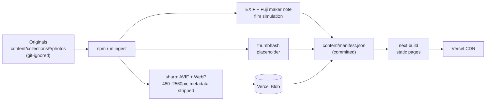

# shotsbybrookss

Photography portfolio for Brooks Barrett, shot on a Fujifilm X-T50.
Live at **[shotsbybrookss.vercel.app](https://shotsbybrookss.vercel.app)**.


The site opens on a globe. Scroll, and it pins and walks through every place the photos were taken, in travel order: the route draws itself, and a readout gives each stop's coordinates, local time and frame count. Every photo carries its own camera data (shutter, aperture, ISO, focal length, and the Fujifilm film simulation), read straight from the original file.

## Stack

|                                         |                                                                                                  |
| --------------------------------------- | ------------------------------------------------------------------------------------------------ |
| **Next.js 16** (App Router, TypeScript) | Every page is prerendered; there is no runtime server work.                                      |
| **Tailwind CSS 4**                      | Design tokens in CSS variables.                                                                  |
| **three.js + React Three Fiber**        | Desktop globe: ~18k land dots in one draw call, custom GLSL for dots, arcs, pins and atmosphere. |
| **Canvas 2D**                           | Phone globe: the same projection without WebGL, so three.js never loads on phones.               |
| **GSAP ScrollTrigger + Lenis**          | Pins the globe section and maps scroll to the route.                                             |
| **sharp + exifr**                       | Image derivatives and EXIF; a small custom parser reads Fujifilm maker notes.                    |
| **Vercel Blob**                         | Stores image derivatives outside the repo.                                                       |
| **Vitest + GitHub Actions**             | Lint, typecheck, format, tests and build on every push.                                          |

## How it works



**Image pipeline.** [`scripts/lib/ingest-core.ts`](scripts/lib/ingest-core.ts) reads each original, parses EXIF with exifr, and reads the film simulation with [`src/lib/exif/fuji.ts`](src/lib/exif/fuji.ts). Fuji stores it in a self-contained IFD inside the maker note, so the parser only has to walk one table. It then generates AVIF and WebP at five widths (never upscaled, never above 2560px), computes a thumbhash, uploads to Vercel Blob, and writes the manifest. GPS is stripped from every public file, and any coordinates are rounded to city level before they reach the manifest. Unchanged photos are skipped by content hash, and hand-edited alt text survives re-runs. Photos with recognizable people stay unpublished until their chapter is marked cleared.

**Globe.** Land dots are precomputed from Natural Earth on a Fibonacci lattice and packed as Int16 lat/lng pairs ([`scripts/globe-dots.ts`](scripts/globe-dots.ts)). The [WebGL version](src/components/globe/GlobeCanvas.tsx) draws them as point sprites that warm toward the active stop. Each travel arc is a tube whose UVs run along the curve, so drawing it is a single uniform. [`rotationToFace`](src/components/globe/geo3d.ts) works out the Euler rotation that turns any city to the camera, north up; it's tested for exactness. Phones get a [2D-canvas version](src/components/globe/Globe2D.tsx) with the same math.

**Colophon numbers** ([/colophon](https://shotsbybrookss.vercel.app/colophon)) are generated, not typed: photo counts and bytes saved come from the manifest, and build time plus Lighthouse scores come from `npm run stats`. The code excerpts on that page are pulled from this repo's source at build time.

## Scripts

```bash
npm run dev          # local dev server
npm run ingest       # process new photos (see HOW_TO_ADD_PHOTOS.md)
npm test             # pipeline, EXIF, geo and globe-math tests
npm run stats        # timed build + Lighthouse → src/data/build-stats.json
npm run globe:dots   # regenerate the land-dot data (rarely needed)
npm run fixture -- japan   # drop a synthetic X-T50 JPEG into a chapter to try the pipeline
```

Adding photos: [HOW_TO_ADD_PHOTOS.md](HOW_TO_ADD_PHOTOS.md). Design and engineering choices: [DECISIONS.md](DECISIONS.md).

## Credits

Fonts: Inter Tight (Rasmus Andersson), Geist and Geist Mono (Vercel), all SIL OFL. Land data: Natural Earth, public domain, via world-atlas.
